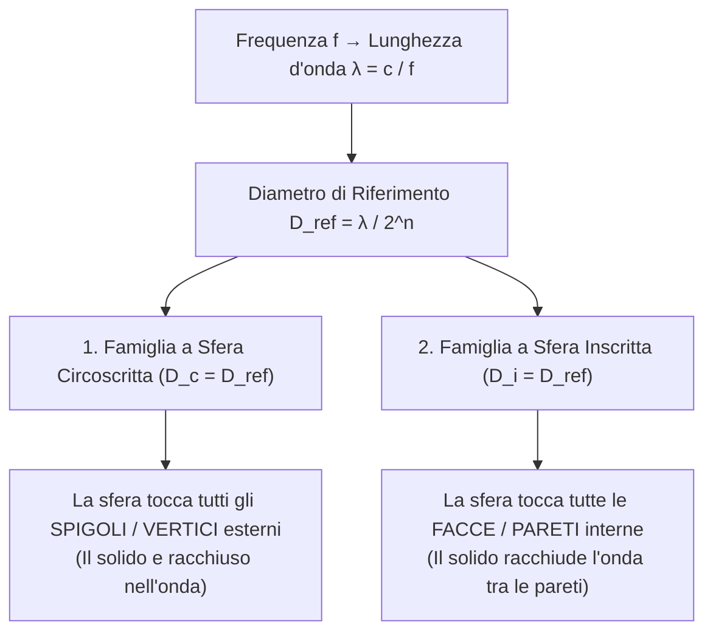
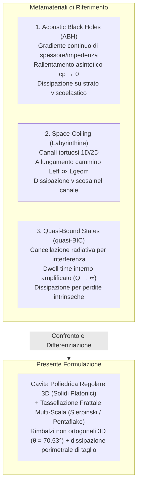

# Calcolatore Matematica Acustica & Progettazione di Smorzatori Geometrici

Strumento computazionale e quadro di ricerca teorica per la modellazione geometrico-analitica di cavità risonanti e smorzatori acustici basati sui Solidi Platonici e su aperture frattali auto-simili.

---

## 1. Guida Rapida all'Uso del Software

Il programma calcola deterministicamente tutte le quote dimensionali, angolari e costruttive per i 5 Solidi Platonici (Tetraedro, Cubo, Ottaedro, Dodecaedro, Icosaedro), partendo dalla frequenza sonora target da attenuare.

### Requisiti
* Python 3.8+ (libreria standard, nessuna dipendenza esterna richiesta).

### Comandi Principali

```bash
# Esecuzione standard con frequenza target (f = 340 Hz, velocita standard c = 340 m/s)
python3 calcolatore.py -f 340 -c 340

# Calcolo con temperatura ambiente reale (calcola c termodinamica esatta)
python3 calcolatore.py -f 120 -t 20.0

# Calcolo di ordine sub-armonico / compatto (es. quarto d'onda D = lambda / 4)
python3 calcolatore.py -f 120 -n 2

# Calcolo con fori a suddivisione frattale (es. k=2 o k=3 iterazioni di Sierpinski)
python3 calcolatore.py -f 340 -c 340 -k 2

# Selezione della sola famiglia a sfera circoscritta o inscritta
python3 calcolatore.py -f 340 -m circoscritto
python3 calcolatore.py -f 340 -m inscritto
```

### Parametri da Linea di Comando (CLI)

| Parametro | Tipo | Default | Descrizione |
| :--- | :---: | :---: | :--- |
| `-f`, `--frequenza` | `float` | *Richiesto* | Frequenza acustica target in Hertz (es. `340.0=1m`). |
| `-c`, `--velocita` | `float` | `340.0` | Velocità di propagazione del suono in m/s. |
| `-t`, `--temperatura` | `float` | `None` | Temperatura aria in °C (calcola $c(T)$ se non specificata `-c`). |
| `-n`, `--ordine` | `int` | `0` | Ordine di frazionamento armonico: $D = \lambda / 2^n$ ($0 \to \lambda$, $1 \to \lambda/2$, $2 \to \lambda/4$). |
| `-k`, `--frattale` | `int` | `None` | Ordine frattale di rimozione facce per le aperture dissipative ($k \ge 1$). |
| `-m`, `--modo` | `str` | `entrambi` | Modello di riferimento: `circoscritto`, `inscritto`, `entrambi`. |

### Esecuzione dei Test di Verifica Matematica

```bash
# Test di consistenza geometrica bidirezionale diretta <-> inversa (errore < 1e-12)
python3 test_matematica.py

# Test delle leggi di scala e convergenza termo-viscosa delle aperture frattali
python3 test_frattali.py
```

---

## 2. Quadro Teorico della Ricerca

### 2.1 Il Problema Fisico e l'Obiettivo Applicativo
Negli ambienti produttivi e industriali, macchinari stazionari (motori, pompe, compressori, trasformatori) emettono spesso rumore tonale concentrato su frequenze stazionarie ben definite a bassa e media frequenza ($50\text{--}500\,\text{Hz}$).
I fonoassorbenti porosi convenzionali (lana di roccia, poliuretano espanso) dissipano per attrito viscoso interno ma richiedono uno spessore nominale pari ad almeno un quarto di lunghezza d'onda:
$$d_{\text{min}} \approx \frac{\lambda}{4} = \frac{c}{4f}$$
A $100\,\text{Hz}$, servirebbe un pannello spesso circa $85\,\text{cm}$, impraticabile dal punto di vista dello spazio e dei carichi strutturali.

**Obiettivo della ricerca**: Progettare un dispositivo risonante compatto (smorzatore / trappola acustica) basato sulla geometria dei poliedri regolari e su tassellazioni frattali auto-simili, che incanali la specifica frequenza tonale all'interno di una cavità risonante e ne massimizzi la dissipazione per attrito viscoso e rilassamento termico lungo i bordi delle aperture e sulle pareti interne.

---

### 2.2 Cinematica dell'Onda e Invarianza di Scala

La velocità del suono nell'aria secca è modellata secondo la termodinamica del gas ideale adiabatico:
$$c(T) = \sqrt{\gamma R_s (T_C + 273.15)}$$
con $\gamma = 1.40$ (rapporto tra calori specifici) e $R_s = 287.05\,\text{J}/(\text{kg}\cdot\text{K})$.
La lunghezza d'onda fondamentale associata alla frequenza $f$ è:
$$\lambda = \frac{c}{f}$$

Per consentire l'analisi sia a scala d'onda intera sia su sottomultipli costruttivi compatti, definiamo il **diametro della sfera di riferimento**:
$$D_{\text{ref}} = \frac{\lambda}{2^n}, \quad n \in \mathbb{N}_0$$

---

### 2.3 Geometria Analitica dei 5 Solidi Platonici

Il calcolatore implementa le relazioni algebriche chiuse e inverse per i 5 solidi platonici regolari secondo due famiglie distinte:



#### Formule Inverse per la Sfera Circoscritta ($R_c = D_c / 2$)

| Solido | Facce | Spigolo Inverso ($a$) | Sfera Inscritta ($D_i$) | Altezza Ingombro ($H$) | Angolo Diedro ($\theta$) |
| :--- | :---: | :---: | :---: | :---: | :---: |
| **Tetraedro** | 4 | $a = \frac{4}{\sqrt{6}} R_c = \frac{\sqrt{6}}{3} D_c$ | $D_i = \frac{1}{3} D_c$ | $H = \frac{2}{3} D_c$ | $\arccos(1/3) \approx 70.53^\circ$ |
| **Cubo** | 6 | $a = \frac{2}{\sqrt{3}} R_c = \frac{\sqrt{3}}{3} D_c$ | $D_i = a = \frac{1}{\sqrt{3}} D_c$ | $H = a$ | $90.00^\circ$ |
| **Ottaedro** | 8 | $a = \sqrt{2} R_c = \frac{\sqrt{2}}{2} D_c$ | $D_i = a \frac{\sqrt{6}}{3} = \frac{1}{\sqrt{3}} D_c$ | $H = D_c$ | $\arccos(-1/3) \approx 109.47^\circ$ |
| **Dodecaedro** | 12 | $a = \frac{4 R_c}{\sqrt{3}(1+\sqrt{5})} = \frac{\sqrt{15}-\sqrt{3}}{6} D_c$ | $D_i = a \sqrt{\frac{25+11\sqrt{5}}{10}}$ | $H = D_i$ | $\arccos(-1/\sqrt{5}) \approx 116.57^\circ$ |
| **Icosaedro** | 20 | $a = \frac{4 R_c}{\sqrt{10+2\sqrt{5}}} = \frac{2 D_c}{\sqrt{10+2\sqrt{5}}}$ | $D_i = a \frac{\sqrt{3}(3+\sqrt{5})}{6}$ | $H = D_c$ | $\arccos(-\sqrt{5}/3) \approx 138.19^\circ$ |

#### Formule Inverse per la Sfera Inscritta ($R_i = D_i / 2$)

| Solido | Spigolo Inverso da $D_i$ ($a$) | Sfera Circoscritta Risultante ($D_c$) | Altezza Ingombro ($H$) |
| :--- | :---: | :---: | :---: |
| **Tetraedro** | $a = \sqrt{6}\, D_i \approx 2.4495 \cdot D_i$ | $D_c = 3 D_i$ | $H = 2 D_i$ |
| **Cubo** | $a = D_i$ | $D_c = \sqrt{3}\, D_i \approx 1.7321 \cdot D_i$ | $H = D_i$ |
| **Ottaedro** | $a = \frac{\sqrt{6}}{2}\, D_i \approx 1.2247 \cdot D_i$ | $D_c = \sqrt{3}\, D_i \approx 1.7321 \cdot D_i$ | $H = \sqrt{3}\, D_i$ |
| **Dodecaedro** | $a = \frac{D_i}{\sqrt{\frac{25+11\sqrt{5}}{10}}} \approx 0.4490 \cdot D_i$ | $D_c \approx 1.2584 \cdot D_i$ | $H = D_i$ |
| **Icosaedro** | $a = \sqrt{3}(3-\sqrt{5})\, D_i \approx 0.6616 \cdot D_i$ | $D_c \approx 1.2584 \cdot D_i$ | $H \approx 1.2584 \cdot D_i$ |

#### Teorema del Rapporto Superficie/Volume ($S/V$) nei Poliedri Circoscritti
Per qualsiasi poliedro convesso circoscritto a una sfera di raggio $R_i$, il volume complessivo coincide con la somma dei volumi delle piramidi aventi ciascuna faccia come base e il centro della sfera come vertice:
$$V = \sum_{j=1}^{N_f} \frac{1}{3} S_j R_i = \frac{1}{3} S_{\text{totale}} R_i$$
Da cui discende l'invariante rigoroso:
$$\frac{S}{V} = \frac{3}{R_i} = \frac{6}{D_i}$$
Per $D_i = 1.00\,\text{m}$, **tutti i 5 solidi platonici presentano identico rapporto $S/V = 6.00\,\text{m}^{-1}$**, mentre nel modello a sfera circoscritta il Tetraedro massimizza la superficie specifica ($S/V = 18.00\,\text{m}^{-1}$ a $D_c = 1\,\text{m}$).

---

### 2.4 Modellazione delle Aperture Frattali e Dissipazione Termo-Viscosa

Per convertire il solido da cavità chiusa (che rifletterebbe l'onda come un corpo rigido) a trappola acustica aperta, si applica la **rimozione di sotto-facce auto-simili** all'ordine di iterazione $k \ge 1$:

1. **Facce triangolari (Tetraedro, Ottaedro, Icosaedro)**:
   * Tassellazione diadica di Sierpinski: ad ogni iterazione lo spigolo del foro è $a_k = a / 2^k$.
   * Numero di fori per faccia: $N_{f,k} = 3^{k-1}$.
2. **Facce quadrate (Cubo)**:
   * Tassellazione triadica di Sierpinski Carpet: spigolo del foro $a_k = a / 3^k$.
   * Numero di fori per faccia: $N_{f,k} = 8^{k-1}$.
3. **Facce pentagonali (Dodecaedro)**:
   * Tassellazione aurea del Pentaflake: spigolo del foro $a_k = a / \phi^{2k}$.
   * Numero di fori per faccia: $N_{f,k} = 5^{k-1}$.

#### Meccanismo Fisico di Dissipazione Viscosa
Il fluido viscoso dell'aria oscilla attraverso le aperture con velocità di picco $u$.
Lo strato limite viscoso su pareti rigide ha spessore:
$$\delta_v = \sqrt{\frac{2\mu}{\rho_0 \omega}} \approx 0.12\,\text{mm a } 340\,\text{Hz}$$
La dissipazione viscosa per unità di lunghezza del bordo del foro è governata dalla tensione di taglio tangenziale $\tau = \mu \left.\frac{\partial u}{\partial n}\right|_{\text{parete}}$.

All'aumentare dell'ordine frattale $k$:
$$\begin{aligned}
A_{\text{tot}, k} &\propto \left(\frac{3}{4}\right)^k \xrightarrow{k \to \infty} 0 \\
P_{\text{tot}, k} &\propto \left(\frac{3}{2}\right)^k \xrightarrow{k \to \infty} +\infty
\end{aligned}$$
Il rapporto perimetro/area del foro cresce come $2^k$: i fori diventano micro-perforazioni in cui il numero adimensionale di Womersley $s = r_h / \delta_v$ scende al di sotto di 100, massimizzando la caduta di pressione per attrito e convertendo l'energia acustica incidente in calore.

---

### 2.5 Modelli di Confinamento d'Onda dello Stato dell'Arte e Differenze Chiave

Per collocare rigorosamente la nostra ricerca nel panorama scientifico contemporaneo, confrontiamo l'approccio proposto con i tre principali paradigmi di "trappola acustica" della letteratura:



| Modello | Meccanismo di Trappola | Meccanismo Dissipativo Reale | Differenza rispetto al Nostro Studio |
| :--- | :--- | :--- | :--- |
| **Acoustic Black Holes (ABH)** | Gradiente continuo di impedenza/spessore a legge di potenza ($h(x) = \epsilon x^m$). La velocità di fase decade a zero ($c_p \to 0$), comprimendo l'onda verso la punta. | Strato viscoelastico o film polimerico posto sulla punta tronca per assorbire l'energia concentrata. | L'ABH richiede una variazione geometrica continua unidimensionale (profilo parabolico/cubico). Il nostro studio opera su volumi poliedrici discreti a pareti piane con forature discrete. |
| **Space-Coiling (Avvolgimento Spaziale)** | Canali labirintici o a zig-zag che allungano il cammino effettivo ($L_{\text{eff}} \gg L$). L'indice di rifrazione efficace diverge ($n_{\text{eff}} \gg 1$), abbassando la frequenza di risonanza in spessori sub-lunghezza d'onda. | Attrito viscoso e perdite termiche sulle pareti interne dei canali stretti bagnati dall'onda guidata. | Lo space-coiling forza l'onda in guide d'onda 1D/2D ripiegate. Il nostro modello sfrutta una cavità volumetrica tridimensionale (3D) dove i rimbalzi avvengono su facce non parallele (es. angoli diedri acuti a $70.53^\circ$). |
| **Quasi-Bound States in the Continuum (quasi-BIC)** | Interferenza distruttiva totale tra canali di radiazione verso l'esterno. L'energia rimane intrappolata nella cavità per tempi lunghissimi con fattore di merito radiativo quasi infinito ($Q_{\text{rad}} \to \infty$). | Amplificazione del tempo di permanenza (dwell time $\tau \propto Q$), permettendo anche a minime perdite intrinseche del materiale ($1/Q_{\text{int}}$) di assorbire l'energia. | I quasi-BIC richiedono una regolazione di fase estremamente rigida a banda strettissima. Il nostro studio sfrutta la suddivisione frattale per generare aperture su scale multiple ($a/2^k$), esplorando un accoppiamento distribuito e l'attrito viscoso lungo il perimetro bagnato. |

---

## 3. Matrice Epistemologica di Rigore Scientifico

In conformità al principio fondamentale del progetto, si distinguono esplicitamente le certezze dimostrate dalle congetture in corso di validazione:

| Aspetto | Stato Epistemologico | Metodo di Validazione |
| :--- | :---: | :--- |
| **Relazioni geometriche chiuse e inverse dei solidi** | **Dimostrato matematicamente** | Verificato con tolleranza numerica $|\Delta| < 10^{-15}$ in `test_matematica.py`. |
| **Invariante $S/V = 6/D_i$ nei poliedri circoscritti** | **Dimostrato matematicamente** | Dimostrazione geometrica rigorosa tramite scomposizione in piramidi. |
| **Crescita esponenziale del perimetro frattale $P(k)$** | **Dimostrato matematicamente** | Dimostrazione analitica della serie geometrica $(3/2)^k$ in `test_frattali.py`. |
| **Risonanza modale interna a $D = \lambda$** | **Ipotesi da ridefinire** | Per il Cubo, la risonanza fondamentale avviene a $a = \lambda/2$, non $a = \lambda$. I modi propri delle cavità non-ortogonali richiedono risoluzione dell'equazione di Helmholtz continua. |
| **Coefficiente di assorbimento reale $\alpha(f)$** | **Congettura progettuale da validare** | Richiede il calcolo dell'impedenza acustica specifica della perforazione $Z_{\text{in}}$ e verifica sperimentale (tubo di Kundt / simulazione FEM termoacustica). |

---

## 4. Roadmap dei Prossimi Sviluppi

1. **Modellazione dell'Impedenza Acustica di Ingresso ($Z_{\text{in}}$)**:
   * Estensione della teoria delle micro-perforazioni di Maa alle geometrie triangolari e pentagonali.
   * Calcolo analitico del coefficiente di assorbimento normale:
     $$\alpha(f) = 1 - \left|\frac{Z_{\text{in}} - \rho_0 c}{Z_{\text{in}} + \rho_0 c}\right|^2$$
2. **Esportazione CAD / Script Generativo 3D**:
   * Generatore di coordinate di vertici e facce (formato `.obj` / `.stl` / script Python per Blender e OpenSCAD) per la prototipazione e stampa 3D delle celle risonanti.
3. **Calcolo degli Autovalori della Cavità (Modi Propri)**:
   * Formalizzazione analitica dei modi di Lamé per il triangolo/tetraedro e confronto con la cavità cubica.
